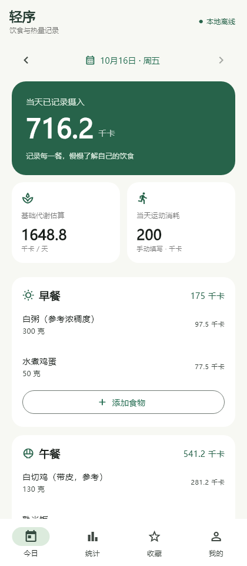
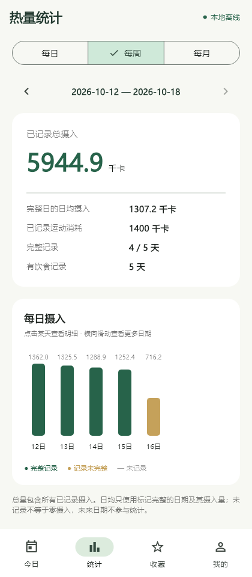
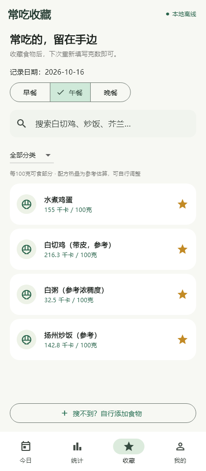
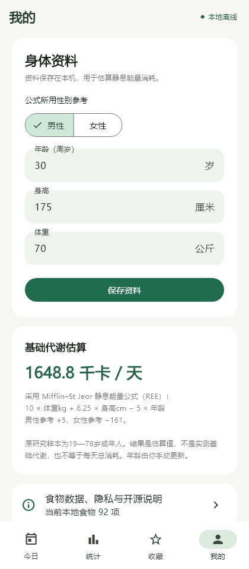

# 轻序 Qingxu

**饮食与热量记录：以粤式饮食为主的中文离线安卓应用。**

输入每餐食物的克数，查看热量摄入；收藏常吃的食物，记录每日运动消耗，再按日、周、月查看趋势。

本项目是基于 [OpenNutriTracker v2.4.0](https://github.com/simonoppowa/OpenNutriTracker/tree/v2.4.0) 开发的中文离线衍生版本，原作者为 **[Simon Oppowa（@simonoppowa）](https://github.com/simonoppowa)** 及其贡献者。轻序由 [@ljf66688](https://github.com/ljf66688) 维护，与上游官方发行版区分。代码沿用 **GPLv3**，详见 [LICENSE](LICENSE) 和 [作者与来源](ATTRIBUTION.md)。

## 界面预览

下图来自应用真实组件的自动化截图，使用隔离的示例数据。首次安装的日记为空。

| 今日三餐 | 日周月统计 | 常吃收藏 | 身体资料 |
| --- | --- | --- | --- |
|  |  |  |  |

[查看全部22张界面与弹窗预览](docs/screenshots/qingxu/README.md)

## 已实现的功能

- **三餐记录**：早餐、午餐、晚餐分别记录；搜索食物，显示每100克千卡值，修改克数后计算热量并添加。支持修改、删除与估算标记。
- **粤式食物库**：本地搜索中文名、常见别名和部分繁体名称；收藏常吃食物，复用最近克数。
- **个人食物**：自建食物、修改个人热量参考值，也可恢复默认值；历史记录保存当时快照。
- **代谢估算**：输入性别公式参考、周岁年龄、身高和体重，采用成人 Mifflin–St Jeor 静息能量估算公式，当前资料范围为19—78岁。
- **运动消耗**：每日手填运动总千卡，可替换或清空，与食物摄入分别展示。
- **每日／每周／每月统计**：周一至周日、自然月；总量包含所有已记录摄入，日均只纳入标记完整的日期。
- **离线保存**：离线入口无需账号、API Key 或后端；Hive AES 加密本地存储，密钥由系统安全存储保护。离线 release 变体移除联网权限。

食物热量计算：`摄入千卡 = 每100克千卡 × 食用克数 ÷ 100`。

静息能量估算不等于全天总消耗；运动手填数据不从摄入统计中扣除。卸载应用或清除数据会删除本地记录；当前离线版本尚未实现备份导入导出。

## 食物数据与适用范围

当前食物库共 **92项**：42项 USDA SR Legacy 基础食物，50项本项目编写的粤式／家常**示例配方估算**。每项保留来源或配料与参考重量。配方、油量、可食部和烹调含水量不同会影响热量，不能当作所有餐馆同名菜的精确数值。

[数据来源与许可](assets/offline/README.md) · [食物库](assets/offline/foods.json) · [USDA溯源](assets/offline/usda_provenance.json)

## 当前进度

当前离线版本：**0.1.1-offline（versionCode 2）**，目标 Android 8.0 及以上。仓库分享介绍、预览和完整 Flutter 源码；尚未通过本仓库发布 APK 或上架应用商店。

已有开发验证记录：专项35项通过，预览测试通过并生成22张截图，全工程静态分析通过，release 构建与签名验证通过。本次仓库发布仅修改文档、忽略规则和参考工作流位置，未重新运行应用构建。此前全量上游测试有2项 Windows IPv6 联网失败；尚未完成安卓真机安装、升级和断网冷启动验证。详见[验证与限制](docs/validation.md)。

## 开发运行

使用 Flutter **3.44.6**（见 [.fvmrc](.fvmrc)）、Java 17、Android SDK 36。首次下载 SDK 和依赖需要联网；Windows 建议把源码放到英文路径，例如 `C:\dev\qingxu`。

```powershell
Copy-Item .env.example .env
flutter pub get
flutter gen-l10n
dart run build_runner build
flutter run --flavor offline -t lib/offline_main.dart
```

`.env.example` 是供原工程代码生成使用的占位模板，离线版无需填入真实服务密钥。调试版使用开发签名。release 构建需要自行配置本地 `android/key.properties` 与私钥，不要提交这些文件。

```powershell
flutter analyze
flutter test test/offline test/unit_test/meal_nutriments_entity_test.dart
flutter build apk --release --flavor offline -t lib/offline_main.dart --build-name 0.1.1 --build-number 2
```

`lib/offline_main.dart` 是轻序入口；保留的 `lib/main.dart` 是上游原版入口，功能与配置要求不同。上游的服务器、AI、扫码、健康同步及 iOS 功能不属于轻序离线版已交付功能。

[离线版使用与构建说明](docs/离线版开发与使用说明.md) · [源码阅读说明](源码阅读说明.md) · [发布检查](docs/publication-check.md)

## 目录导航

| 路径 | 内容 |
| --- | --- |
| `lib/offline/` | 离线版数据、计算和界面 |
| `assets/offline/` | 食物与溯源数据 |
| `test/offline/` | 计算、存储、界面预览检查 |
| `tools/offline/` | Windows构建与食物库生成工具 |
| `docs/screenshots/qingxu/` | 轻序全部界面预览 |
| `docs/upstream-workflows/` | 上游自动化参考，未作为本仓库工作流启用 |
| `README.upstream.md` | 保留的上游项目介绍 |

## 作者、许可与反馈

感谢 OpenNutriTracker 原作者 Simon Oppowa、[上游贡献者](https://github.com/simonoppowa/OpenNutriTracker/graphs/contributors)及各依赖项目。复用范围与改动日期见 [ATTRIBUTION.md](ATTRIBUTION.md)。原始版权和许可声明保留，数据与第三方素材分别遵循其声明的许可。

代码采用 [GNU GPLv3](LICENSE)：允许使用、修改、分享和商业使用；分发衍生软件时应遵守同许可证、版权声明及对应源码提供要求。[许可证选项解释](docs/GitHub发布指南.md#许可证怎么选)

问题与建议请提交到[本仓库 Issues](https://github.com/ljf66688/qingxu/issues)。
