# 轻序全部界面预览

以下22张截图来自应用组件和隔离的示例内存数据，不含真实用户记录。点击图片可查看原图。

[返回项目首页](../../../README.md)

## 今日三餐

## 今日明细

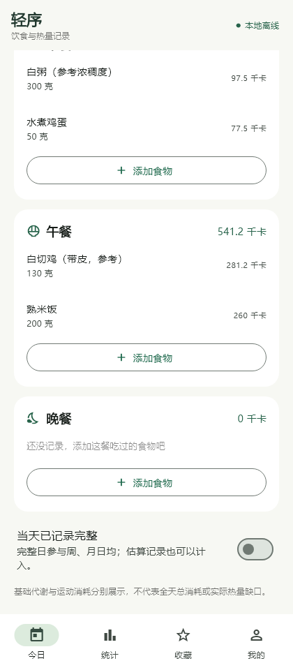

## 每周统计

## 每日统计

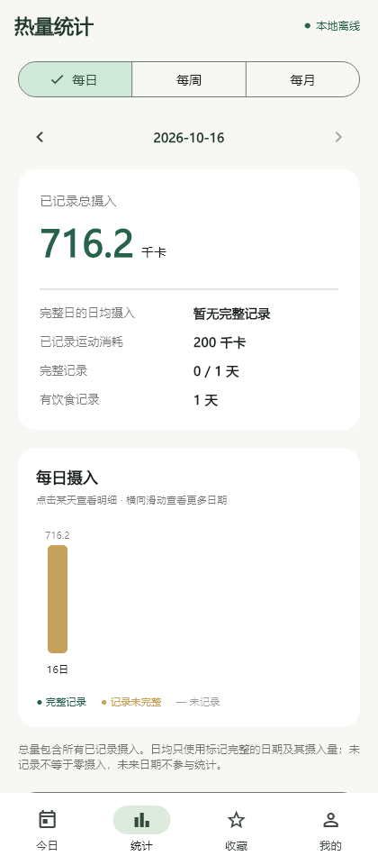

## 每月统计

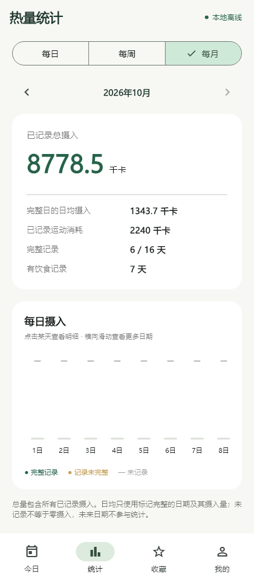

## 收藏

## 身体资料

## 代谢公式

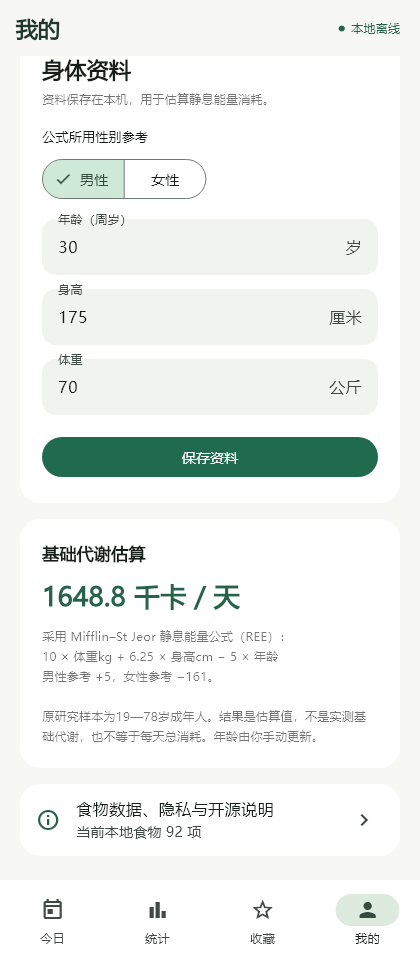

## 浏览食物

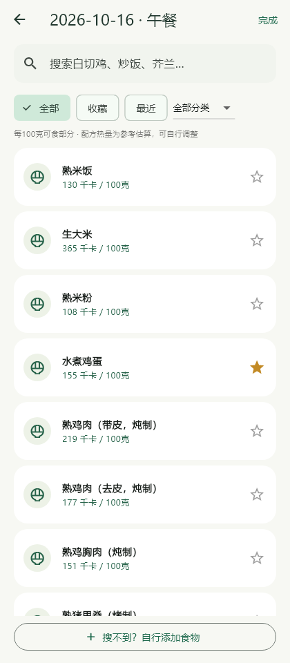

## 搜索食物

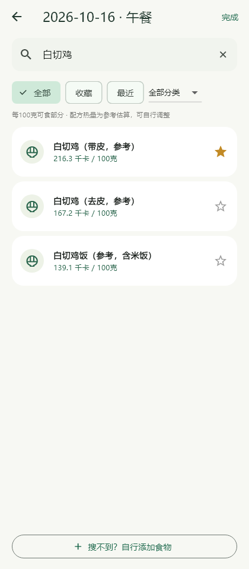

## 克数与添加

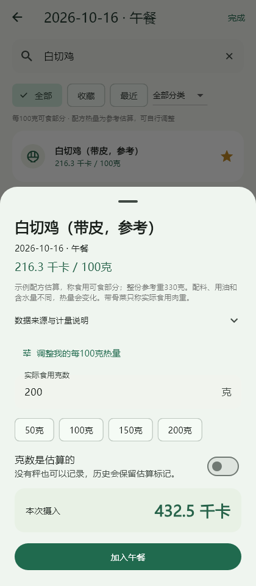

## 食物来源

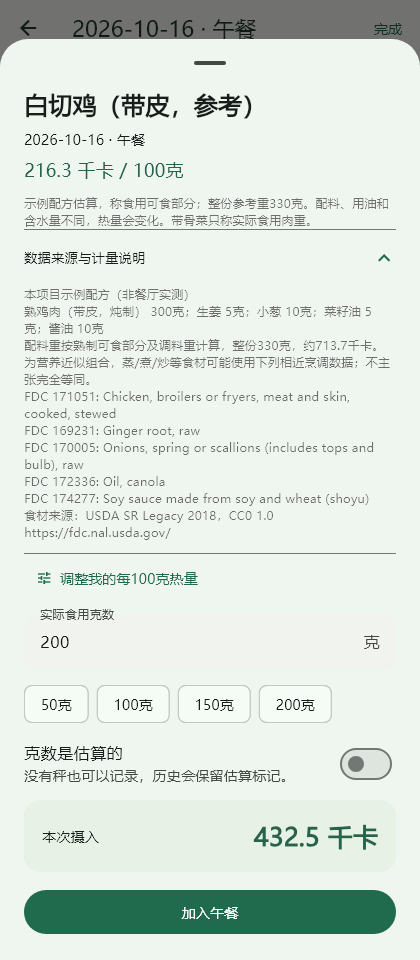

## 个人热量参考值

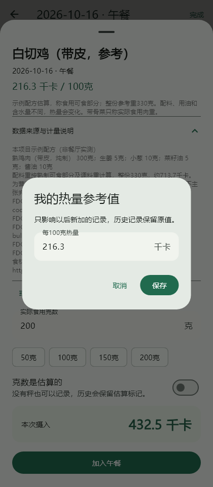

## 自建食物

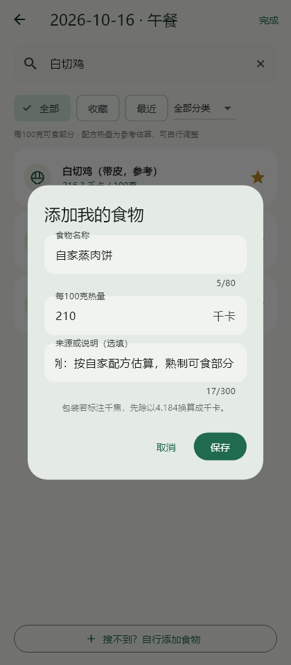

## 编辑记录

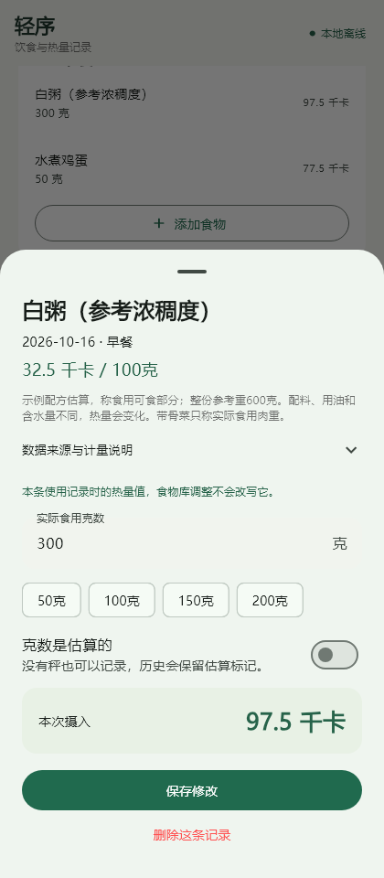

## 删除记录

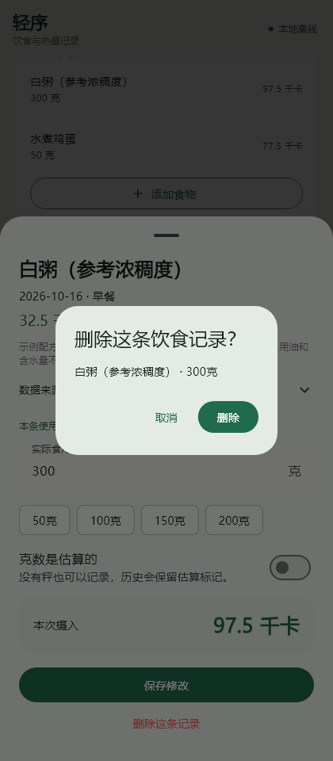

## 运动消耗

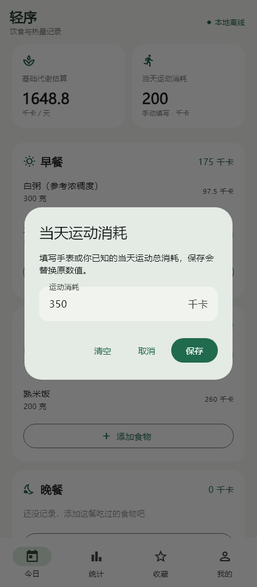

## 完整日标记

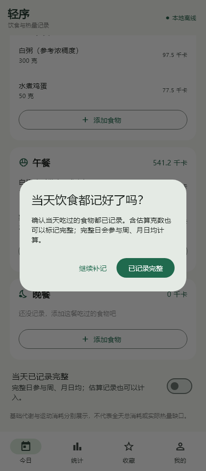

## 选择日期

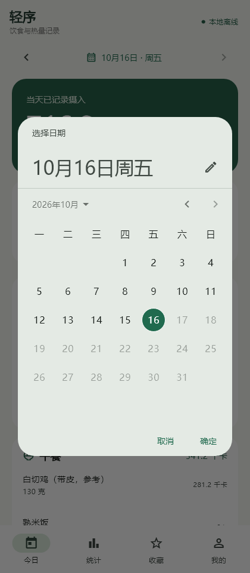

## 关于轻序

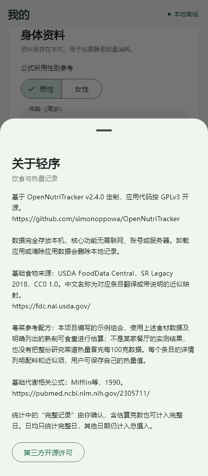

## 开源许可

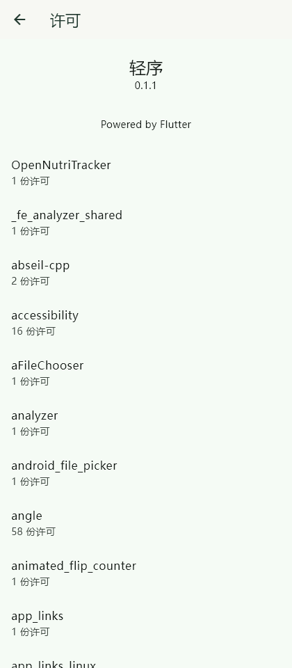

## 许可详情

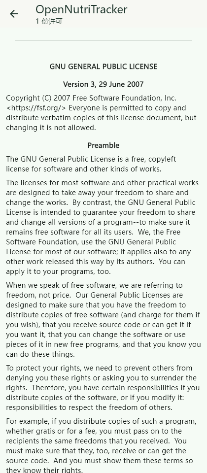

